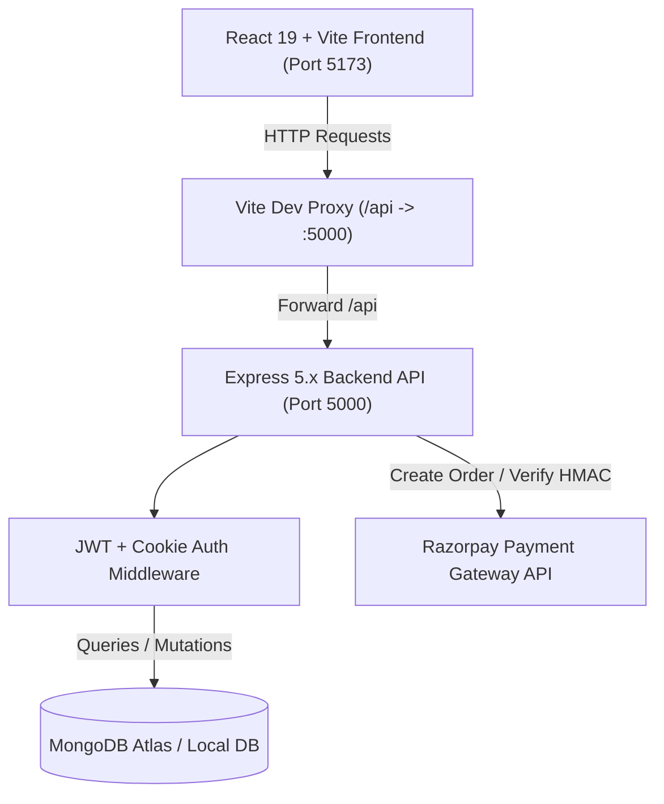
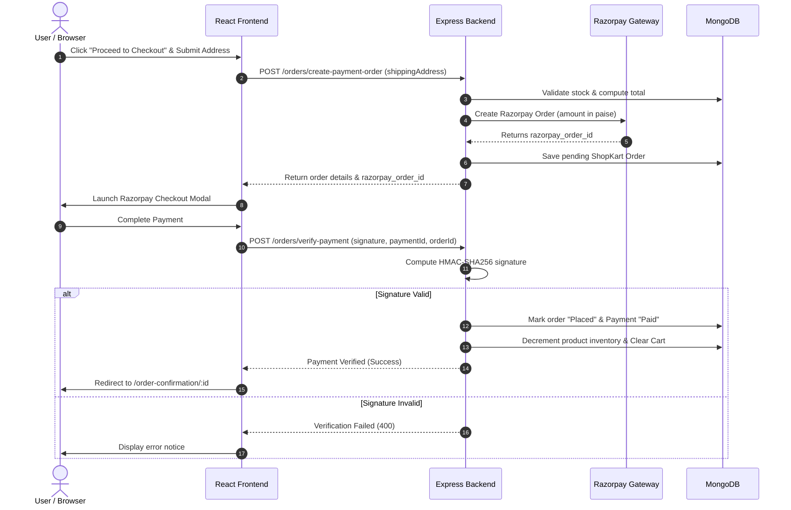

<div align="center">

# 🛒 ShopKart — Modern Full-Stack E-Commerce Platform

An end-to-end, production-ready MERN stack e-commerce web application featuring user authentication, product catalog with dynamic filtering, real-time wishlist, shopping cart state management, Razorpay payment gateway integration with HMAC-SHA256 cryptographic verification, and comprehensive order lifecycle management.

[](https://react.dev/)
[](https://vitejs.dev/)
[](https://nodejs.org/)
[](https://expressjs.com/)
[](https://www.mongodb.com/)
[](https://razorpay.com/)
[](LICENSE)

---

[Key Features](#-key-features) •
[System Architecture](#-system-architecture) •
[Tech Stack](#-tech-stack) •
[Directory Structure](#-directory-structure) •
[API Reference](#-api-reference) •
[Security & Environment Setup](#-security--environment-setup) •
[Installation & Quickstart](#-installation--quickstart) •
[Automated Tests](#-automated-testing)

</div>

---

## 🌟 Overview

**ShopKart** is built as a modular, progressive e-commerce solution that covers the complete customer journey from account registration and discovery to secure checkout and post-purchase tracking.

The project demonstrates:
- Secure JWT-based authentication using HTTP-Only cookies with authorization header fallbacks.
- Product querying with debounced search, multi-category filtering, and dynamic pricing sort.
- Synchronized cart and wishlist states backed by MongoDB schemas.
- Server-side inventory validations and atomic stock decrement on order finalization.
- Two-step payment flow with Razorpay Orders API and server-side HMAC-SHA256 signature verification.
- Interactive testing mode and automated test suites verifying all critical edge cases.

---

## 🚀 Key Features

### 1. 🔐 Customer Authentication & Security
- User registration and login with bcrypt password hashing (salt rounds: 10).
- Stateless JSON Web Token (`JWT`) authentication stored in secure HTTP-Only cookies.
- Cross-origin credentials support with automatic fallback to `Bearer` token header.
- Protected route middleware (`auth.middleware.js`) verifying credentials on protected endpoints.
- User profile retrieval and clean logout clearing stored tokens.

### 2. 🛍️ Product Catalog & Discovery
- Responsive product listing with responsive grid layouts.
- Real-time search across product names and descriptions using case-insensitive regex.
- Category filtering (`Electronics`, `Fashion`, `Home`, `Fitness`, etc.).
- Price sorting (Low to High, High to Low).
- Detailed single product views with stock status, specifications, and fast add-to-cart/wishlist triggers.

### 3. 💖 Interactive Wishlist
- Add or remove items from personal wishlist with optimistic UI feedback.
- Toggle API (`PATCH /wishlist/:productId/toggle`) for seamless heart-icon interactions.
- Full product population on retrieval so users immediately see price, stock, and image metadata.
- Instant item movement from Wishlist directly to Cart.

### 4. 🛒 Dynamic Shopping Cart
- Real-time cart calculations (subtotal, shipping calculation, taxes, and final payable amount).
- Quantity modification with inventory upper-bound checks.
- Safe item removal and one-click cart clearing.
- Cart persistence across sessions directly in the MongoDB customer profile.

### 5. 💳 Razorpay Checkout & Payment Verification
- **Step 1 — Server Order Creation**:
  - Validates cart is non-empty.
  - Verifies stock availability against the latest database inventory.
  - Generates immutable purchase-time snapshots of product title, price, and quantity.
  - Creates an official Razorpay order in paise (`INR`) via the Razorpay Node SDK.
- **Step 2 — Interactive Payment Interface**:
  - Emulates and integrates standard checkout with Razorpay sandbox.
  - Handles successful transactions and simulated failures/cancellations gracefully.
- **Step 3 — Cryptographic Signature Verification**:
  - Generates expected signature using `crypto.createHmac("sha256", RAZORPAY_KEY_SECRET)` on `razorpay_order_id|razorpay_payment_id`.
  - Constant-time verification to prevent timing attacks.
  - Atomically decrements product stock and empties user cart upon verification.

### 6. 📦 Order Management & Tracking
- Complete order history page listing past orders with timestamps, status badges, and item summaries.
- Detailed Order Receipt view including shipping address, delivery status, and payment identifiers.
- Order progression tracking: `Placed` ➔ `Processing` ➔ `Shipped` ➔ `Delivered`.

---

## 🏗️ System Architecture



### 💳 Razorpay Payment Flow



---

## 💻 Tech Stack

| Layer | Technologies |
|---|---|
| **Frontend** | React 19, Vite 8, React Router DOM v7, Axios, Lucide React, Modern CSS3 |
| **Backend** | Node.js, Express.js 5, Cookie-Parser, CORS, Dotenv |
| **Database** | MongoDB Atlas / MongoDB 7+, Mongoose ODM 9.x |
| **Authentication** | JSON Web Tokens (`jsonwebtoken`), Bcrypt password hashing |
| **Payment Gateway** | Razorpay Node.js SDK, Node.js Native `crypto` (HMAC-SHA256) |
| **Code Quality** | Oxlint, Nodemon |

---

## 📁 Directory Structure

```text
ShopKart-Lab/
├── .gitignore                   # Root Git ignore rules (protects .env & secrets)
├── README.md                    # Project documentation
├── backend/
│   ├── .env.example             # Safe environment variables template
│   ├── .gitignore               # Backend-specific ignore rules
│   ├── index.js                 # Express server entry point & DB connection
│   ├── package.json             # Backend dependencies & start scripts
│   ├── seedProducts.js          # Database seeder with sample products
│   ├── testLab03.js             # Automated test suite for Lab 03 (Auth & Products)
│   ├── testLab05.js             # Automated test suite for Lab 05 (Cart APIs)
│   ├── testLab06.js             # Automated test suite for Lab 06 (Checkout & Orders)
│   ├── config/
│   │   └── razorpay.js          # Razorpay client instance configuration
│   ├── controllers/
│   │   ├── customer.controller.js # Customer auth & profile logic
│   │   ├── product.controller.js  # Product query & filtering logic
│   │   ├── wishlist.controller.js # Wishlist toggle & populate logic
│   │   ├── cart.controller.js     # Cart CRUD & stock validation logic
│   │   └── order.controller.js    # Razorpay orders & HMAC verification
│   ├── middlewares/
│   │   └── auth.middleware.js   # JWT token authentication middleware
│   ├── models/
│   │   ├── customer.model.js    # Customer schema with embedded cart & wishlist
│   │   ├── product.model.js     # Product schema with price, stock, category
│   │   └── order.model.js       # Order schema with snapshot items & Razorpay IDs
│   ├── routes/
│   │   ├── customer.routes.js   # Auth endpoints (/customers/*)
│   │   ├── product.routes.js    # Product endpoints (/products/*)
│   │   ├── wishlist.routes.js   # Wishlist endpoints (/wishlist/*)
│   │   ├── cart.routes.js       # Cart endpoints (/cart/*)
│   │   └── order.routes.js      # Order & checkout endpoints (/orders/*)
│   └── utils/
│       └── generateToken.js     # JWT generation utility
└── frontend/
    ├── .gitignore               # Frontend ignore rules
    ├── index.html               # Vite HTML entry point
    ├── vite.config.js           # Vite dev server with proxy to :5000
    ├── package.json             # Frontend dependencies & build scripts
    └── src/
        ├── main.jsx             # React application bootstrap
        ├── App.jsx              # Application router & layout structure
        ├── index.css            # Design system, variables, and global styles
        ├── components/
        │   ├── Navbar.jsx       # Global navigation bar with cart/wishlist counters
        │   ├── ProductCard.jsx  # Catalog product item with quick actions
        │   ├── WishlistCard.jsx # Wishlist item display
        │   ├── CartItem.jsx     # Cart item with quantity modifier
        │   ├── CheckoutForm.jsx # Address input form with field validations
        │   ├── OrderSummary.jsx # Pricing summary (subtotal, tax, total)
        │   └── RazorpayModal.jsx# Interactive Razorpay sandbox checkout dialog
        ├── context/
        │   ├── CartContext.jsx  # Global cart state provider
        │   └── WishlistContext.jsx # Global wishlist state provider
        ├── pages/
        │   ├── Home.jsx         # Landing page with banners & categories
        │   ├── Products.jsx     # Search, filter, and catalog grid
        │   ├── ProductDetails.jsx# Single product deep dive
        │   ├── Wishlist.jsx     # Saved items view
        │   ├── Cart.jsx         # Full cart management view
        │   ├── Checkout.jsx     # Address input & payment initialization
        │   ├── OrderConfirmation.jsx # Post-checkout success view
        │   ├── Orders.jsx       # Order history listing
        │   ├── OrderDetails.jsx # Detailed single order invoice
        │   ├── Login.jsx        # User login page
        │   └── Register.jsx     # User signup page
        └── services/
            └── api.js           # Axios API client & endpoints service layer
```

---

## 🔒 Security & Environment Setup

> [!CAUTION]
> **Never commit your `.env` file or sensitive credentials to Git or GitHub.**
> `.env` files contain sensitive MongoDB connection strings, JWT secrets, and Razorpay API keys.

This repository includes a `.gitignore` that prevents `.env` and all secret files from being committed. A template file [`backend/.env.example`](backend/.env.example) is provided for setup.

### Configuring Environment Variables

Navigate to the `backend/` directory, create a `.env` file by copying the template, and supply your own keys:

```bash
cd backend
cp .env.example .env
```

Edit `backend/.env` with your values:

```env
# Server Port
PORT=5000

# MongoDB Connection String
# For MongoDB Atlas:
MONGO_URI=mongodb+srv://<username>:<password>@cluster0.your_cluster.mongodb.net/shopkart?retryWrites=true&w=majority
# Or for Local MongoDB:
# MONGO_URI=mongodb://localhost:27017/shopkart

# JSON Web Token Secret
JWT_SECRET=your_super_secret_jwt_key_here

# Razorpay API Credentials (Test Mode)
# Obtain from https://dashboard.razorpay.com/app/keys
RAZORPAY_KEY_ID=rzp_test_your_key_id
RAZORPAY_KEY_SECRET=your_razorpay_secret_key
```

---

## 🛠️ Installation & Quickstart

### Prerequisites
- [Node.js](https://nodejs.org/) (v18.x or v20.x recommended)
- [MongoDB](https://www.mongodb.com/) (Local instance or MongoDB Atlas account)
- [Git](https://git-scm.com/)

---

### Step 1: Clone the Repository

```bash
git clone https://github.com/sweety123490/ShopKart-Lab.git
cd ShopKart-Lab
```

---

### Step 2: Backend Setup

1. Open a terminal and navigate to `backend/`:
   ```bash
   cd backend
   ```

2. Install dependencies:
   ```bash
   npm install
   ```

3. Setup your environment file:
   ```bash
   cp .env.example .env
   # Open .env and add your MONGO_URI, JWT_SECRET, and RAZORPAY credentials
   ```

4. *(Optional but Recommended)* Seed initial products into MongoDB:
   ```bash
   node seedProducts.js
   ```

5. Start the backend development server:
   ```bash
   npm start
   ```
   The backend server will run at: **`http://localhost:5000`**

---

### Step 3: Frontend Setup

1. Open a new terminal and navigate to `frontend/`:
   ```bash
   cd frontend
   ```

2. Install dependencies:
   ```bash
   npm install
   ```

3. Start the Vite development server:
   ```bash
   npm run dev
   ```
   The application will be accessible at: **`http://localhost:5173`**

---

## 📡 API Reference

### 👤 Customer & Authentication (`/customers`)
| Method | Endpoint | Description | Auth Required |
|---|---|---|---|
| `POST` | `/customers/register` | Register a new user | No |
| `POST` | `/customers/login` | Authenticate user & issue JWT | No |
| `POST` | `/customers/logout` | Clear auth cookies & terminate session | Yes |
| `GET` | `/customers/me` | Fetch authenticated user's profile | Yes |

### 🛍️ Products (`/products`)
| Method | Endpoint | Description | Auth Required |
|---|---|---|---|
| `GET` | `/products` | List products with `search`, `category`, and `sort` | No |
| `GET` | `/products/:id` | Get single product details | No |
| `POST` | `/products` | Create a new product (Admin / Testing) | No |

### 💖 Wishlist (`/wishlist`)
| Method | Endpoint | Description | Auth Required |
|---|---|---|---|
| `GET` | `/wishlist` | Retrieve populated wishlist items | Yes |
| `POST` | `/wishlist/:productId` | Add a product to wishlist | Yes |
| `DELETE` | `/wishlist/:productId` | Remove a product from wishlist | Yes |
| `PATCH` | `/wishlist/:productId/toggle`| Toggle product in wishlist | Yes |

### 🛒 Cart (`/cart`)
| Method | Endpoint | Description | Auth Required |
|---|---|---|---|
| `GET` | `/cart` | Get cart with populated product data & total | Yes |
| `POST` | `/cart/:productId` | Add product to cart (increments if exists) | Yes |
| `PATCH` | `/cart/:productId` | Update item quantity (`{ quantity: Number }`) | Yes |
| `DELETE` | `/cart/:productId` | Remove specific product from cart | Yes |
| `DELETE` | `/cart` | Clear entire shopping cart | Yes |

### 📦 Orders & Payments (`/orders`)
| Method | Endpoint | Description | Auth Required |
|---|---|---|---|
| `POST` | `/orders/create-payment-order` | Validate cart, stock, and create Razorpay order | Yes |
| `POST` | `/orders/verify-payment` | Verify HMAC SHA256 signature & finalize order | Yes |
| `GET` | `/orders` | List all orders placed by the user | Yes |
| `GET` | `/orders/:id` | Fetch single order details by ID | Yes |
| `PATCH`| `/orders/:id/status` | Update order progression status (`Placed` -> `Delivered`) | Yes |

---

## 🧪 Automated Testing

Automated test suites are included in `backend/` to validate all core business rules and edge cases without needing manual UI clicks.

Make sure your backend server is running on port 5000 before running tests:

### 1. Test Lab 03 (Auth & Products)
```bash
cd backend
node testLab03.js
```

### 2. Test Lab 05 (Cart Operations)
Tests cart insertion, quantity updates, inventory boundary validation, and totals:
```bash
cd backend
node testLab05.js
```

### 3. Test Lab 06 (Checkout, Razorpay & Verification)
Validates all 10 criteria specified in Lab 06:
- Empty cart checkout rejection
- Shipping address validation (city, state, 6-digit pincode)
- Stock validation during checkout
- Snapshot order creation with immutable historical prices
- Razorpay order generation with amount in paise
- Cart retention prior to payment verification
- Cryptographic HMAC-SHA256 signature verification
- Stock deduction upon verified payment
- Automatic cart clearing post-payment
- Multi-user order isolation and ownership enforcement

```bash
cd backend
node testLab06.js
```

---

## 📤 Safe Git Push to GitHub

To push your local project to your GitHub repository without exposing `.env` files:

```bash
# 1. Verify you are in the root directory
# (Should see backend/, frontend/, .gitignore, README.md)

# 2. Check that .env is ignored
git status --ignored

# Notice that backend/.env is listed under ignored files (!!)

# 3. Add all allowed files
git add .

# 4. Commit your changes
git commit -m "feat: complete ShopKart platform with Razorpay checkout and clean README"

# 5. Link to your remote GitHub repository (if not already linked)
git remote add origin https://github.com/sweety123490/ShopKart-Lab.git

# 6. Push to main branch
git branch -M main
git push -u origin main
```

---

## 👥 Author

**Sweety Kumari**  
- GitHub: [@sweety123490](https://github.com/sweety123490)
- Repository: [ShopKart-Lab](https://github.com/sweety123490/ShopKart-Lab)

---

## 📄 License

This project is licensed under the [ISC License](LICENSE).
